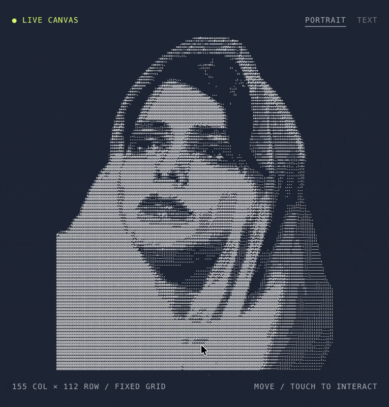

<h1 align="center">Reactive ASCII</h1>

<p align="center">
  <a href="README.md">English</a> · <a href="README.uk.md">Українська</a> · <b>Español</b>
</p>

<p align="center">
  <strong>La imagen se deforma con el puntero. La cuadrícula permanece fija.</strong><br>
  Pega tu propio arte ASCII, ajusta el efecto con los controles y comparte un enlace o copia el código para insertarlo en tu web.
</p>

<p align="center">
  
  <a href="#inicio-rápido"></a>
  
  
  
  
  <a href="LICENSE"></a>
</p>

<p align="center">
  <a href="https://agn0st.github.io/reactive-ascii-playground/demo/"></a>
</p>

<p align="center">
  <a href="#inicio-rápido">Inicio rápido</a> · <a href="#tu-propio-arte">Tu propio arte</a> · <a href="#opciones">Opciones</a> · <a href="#api">API</a> · <a href="#cómo-funciona">Cómo funciona</a>
</p>

<p align="center">
  <a href="https://agn0st.github.io/reactive-ascii-playground/demo/"></a>
</p>

> [!NOTE]
> Cada celda toma un carácter de un punto desplazado del arte original. Al mover el puntero, la imagen se estira y deja un rastro de caracteres que se desvanece. Un efecto opcional de WebGL2 separa los canales de color en la dirección del desplazamiento.

<br>

## Inicio rápido

**1.** Copia `reactive-ascii.js` y `chromatic.js` junto a tu página.

**2.** Añade el lienzo, tu arte y los scripts.

```html
<canvas id="ascii" style="width:100%;height:520px;background:#1F2533"></canvas>
<pre id="ascii-art" hidden>
  tu arte ASCII aquí
</pre>

<script src="chromatic.js"></script>
<script src="reactive-ascii.js"></script>
<script>
  ReactiveAscii.create({ canvas: '#ascii', art: '#ascii-art' });
</script>
```

**3.** Si cambias el fondo, usa el mismo color en el CSS y en la opción
`background`. El sombreador usa ese color para recombinar los canales sin
oscurecer los bordes.

`chromatic.js` es opcional. La deformación y el rastro funcionan con Canvas 2D.

### Sin escribir JavaScript

```html
<canvas data-reactive-ascii data-art="#ascii-art" data-radius="100" data-trail="0.8"></canvas>
```

La biblioteca encuentra el lienzo mediante `data-reactive-ascii`. En el ejemplo
anterior, sustituye el `<canvas>` por esta versión y quita la llamada a
`ReactiveAscii.create()`. Conserva las dimensiones del lienzo, el elemento con
el arte y el script de la biblioteca. Usa guiones en las opciones de varias
palabras, como `data-trail-duration`. Configura `respectReducedMotion` desde
JavaScript.

## Tu propio arte

Puedes usar cualquier texto monoespaciado, desde una foto convertida a ASCII
hasta un logotipo o un bloque de texto. Conserva los espacios al final de las
líneas para mantener la cuadrícula alineada.

Pega el arte en el área de texto de la demo o arrastra un archivo `.txt` al
lienzo. Si tienes una copia del proyecto, también puedes sustituir
[`demo/samples/art.txt`](demo/samples/art.txt), que se carga al iniciar.
Encontrarás otra muestra en [`demo/samples/`](demo/samples).

La URL guarda los ajustes de los controles y la paleta. **Copy link** copia el
enlace con los ajustes actuales y **Copy code** copia el código listo para
insertar en tu página.

## Opciones

| Opción | Valor predeterminado | Descripción |
|---|---|---|
| `art` | — | Cadena, lista de líneas, elemento o selector como `"#selector"` |
| `canvas` | — | Elemento o selector. Obligatorio |
| `radius` | `80` | Alcance del puntero en píxeles |
| `strength` | `0.7` | Intensidad de la deformación, de `0` a `1` |
| `recovery` | `2000` | Tiempo de recuperación en milisegundos |
| `memory` | `1200` | Tiempo de decaimiento de los movimientos anteriores, en milisegundos |
| `limit` | `24` | Desplazamiento máximo en píxeles |
| `aberration` | `0.5` | Separación RGB, de `0` a `1.5`. Requiere `chromatic.js` y WebGL2 |
| `trail` | `0.6` | Densidad del rastro, de `0` a `1`. Usa `0` para desactivarlo |
| `trailDuration` | `1800` | Duración del rastro en milisegundos |
| `color` | `'#F6F4F1'` | Color de los caracteres |
| `background` | `'#1F2533'` | Color del fondo detrás del lienzo |
| `glyphs` | ``'.:;-=+*#%@/\\!?01'`` | Caracteres que se alternan en el rastro |
| `fontSize` | `12` | Tamaño de letra en píxeles a escala 1 |
| `cellWidth` / `cellHeight` | `7.2` / `12` | Dimensiones de la celda a escala 1 |
| `paddingX` / `paddingY` | `32` / `80` | Espacio libre al encajar el arte en el lienzo |
| `respectReducedMotion` | `true` | Respeta `prefers-reduced-motion` |

El arte se ajusta automáticamente al lienzo. `fontSize` y las dimensiones de
las celdas definen las proporciones.

## API

```js
const portrait = ReactiveAscii.create({ canvas: '#ascii', art: myText });

portrait.set({ radius: 120, trail: 0.9 });  // ajusta el efecto en tiempo real
portrait.setArt(otherText);                 // cambia el arte y reconstruye la cuadrícula
portrait.play(2600);                        // reproduce un barrido automático
portrait.reset();                           // borra la deformación y conserva los ajustes
portrait.destroy();                         // elimina los listeners, el observador y la animación

portrait.config;                   // ajustes actuales
portrait.dimensions;               // { rows, cols }
portrait.supported.webgl2;         // false si el efecto RGB no está disponible
ReactiveAscii.defaults;            // objeto con los valores predeterminados
```

## Cómo funciona

<table>
  <tr>
    <td width="50%" valign="top"><h3>▦ Cuadrícula fija</h3><p>Cada celda dibuja un carácter de un punto desplazado del original. La imagen se estira mientras las celdas conservan su posición.</p></td>
    <td width="50%" valign="top"><h3>🌀 Movimiento elástico</h3><p>El movimiento suavizado del puntero deforma el arte. El desplazamiento tiene un límite y decae incluso mientras el puntero sigue moviéndose.</p></td>
  </tr>
  <tr>
    <td width="50%" valign="top"><h3>✨ Rastro de caracteres</h3><p>El rastro aparece sobre todo en las celdas vacías. Al desvanecerse, vuelven a verse los caracteres originales.</p></td>
    <td width="50%" valign="top"><h3>🌈 Separación RGB</h3><p>Un efecto opcional de WebGL2 desplaza los canales rojo y azul en direcciones opuestas a lo largo del desplazamiento local.</p></td>
  </tr>
</table>

## Compatibilidad con navegadores

Funciona en navegadores modernos. Si WebGL2 no está disponible, el control de
aberración se desactiva y el resto del efecto sigue funcionando.
`prefers-reduced-motion` mantiene el arte estático.

## Estructura

```
reactive-ascii.js   motor y API pública
chromatic.js        efecto opcional de aberración con WebGL2
index.html          redirige a la demo desde la raíz del sitio
demo/               controles, paletas, carga de arte y código para insertar
```

## Licencia

MIT. Consulta [LICENSE](LICENSE).
