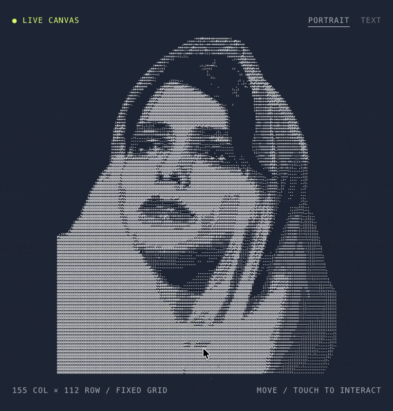

<h1 align="center">Reactive ASCII</h1>

<p align="center">
  <b>English</b> · <a href="README.uk.md">Українська</a>
</p>

<p align="center">
  <strong>The art bends with your pointer. The grid stays put.</strong><br>
  Paste in your own ASCII art, tune the effect with sliders, then share a link or copy the embed code.
</p>

<p align="center">
  
  <a href="#quick-start"></a>
  
  
  
  
  <a href="LICENSE"></a>
</p>

<p align="center">
  <a href="https://agn0st.github.io/reactive-ascii-playground/demo/"></a>
</p>

<p align="center">
  <a href="#quick-start">Quick start</a> · <a href="#your-own-art">Use your own art</a> · <a href="#options">Options</a> · <a href="#api">API</a> · <a href="#how-it-works">How it works</a>
</p>

<p align="center">
  <a href="https://agn0st.github.io/reactive-ascii-playground/demo/"></a>
</p>

> [!NOTE]
> Each cell samples a shifted spot in the original art. Moving the pointer stretches the image and leaves a fading trail of glyphs. An optional WebGL2 pass splits the color channels along the direction of the stretch.

<br>

## Quick start

**1.** Copy `reactive-ascii.js` and `chromatic.js` next to your page.

**2.** Add a canvas, your art, and the scripts:

```html
<canvas id="ascii" style="width:100%;height:520px;background:#1F2533"></canvas>
<pre id="ascii-art" hidden>
  your ASCII art here
</pre>

<script src="chromatic.js"></script>
<script src="reactive-ascii.js"></script>
<script>
  ReactiveAscii.create({ canvas: '#ascii', art: '#ascii-art' });
</script>
```

**3.** If you change the background, use the same colour in CSS and in the `background` option.
The shader needs it to composite the split colour channels without darkening edges.

That is the whole integration. `chromatic.js` is optional — leave it out and the
deformation and trail still run on plain Canvas 2D.

### Without writing any JavaScript

```html
<canvas data-reactive-ascii data-art="#ascii-art" data-radius="100" data-trail="0.8"></canvas>
```

The library finds the canvas through `data-reactive-ascii`. In the example above, replace the `<canvas>` with this version and remove the `ReactiveAscii.create()` call. Keep the canvas sizing, art element and library script. Use hyphens for multiword options, such as `data-trail-duration`. Set `respectReducedMotion` through JavaScript.

## Your own art

Anything monospace works — a converted photo, a logo, or a plain block of text.
Keep the line padding intact; trailing spaces are what hold the grid square.

The playground takes art three ways: paste it into the textarea, drop a `.txt`
file onto the canvas, or replace [`demo/samples/art.txt`](demo/samples/art.txt),
which is what it loads on startup. A plain-text sample sits beside it in
[`demo/samples/`](demo/samples).

Every slider and the palette live in the URL, so a look you like is a link you
can send — **Copy link** puts the current settings on your clipboard. The
**Copy code** button does the same for a ready-to-paste embed snippet.

## Options

| Option | Default | Meaning |
|---|---|---|
| `art` | — | String, array of lines, an element, or a `"#selector"` pointing at one |
| `canvas` | — | Element or selector. Required |
| `radius` | `80` | Pointer reach, px |
| `strength` | `0.7` | How hard the pointer pulls, `0..1` |
| `recovery` | `2000` | Time to settle back, ms |
| `memory` | `1200` | How fast old strokes are forgotten, ms |
| `limit` | `24` | Hard cap on displacement, px |
| `aberration` | `0.5` | RGB split, `0..1.5`. Needs `chromatic.js` + WebGL2 |
| `trail` | `0.6` | Trail density, `0..1`. `0` turns it off |
| `trailDuration` | `1800` | Trail lifetime, ms |
| `color` | `'#F6F4F1'` | Glyph colour |
| `background` | `'#1F2533'` | Must match what is behind the canvas |
| `glyphs` | ``'.:;-=+*#%@/\\!?01'`` | Characters the trail cycles through |
| `fontSize` | `12` | px at scale 1 |
| `cellWidth` / `cellHeight` | `7.2` / `12` | Cell metrics at scale 1 |
| `paddingX` / `paddingY` | `32` / `80` | Space kept free when fitting the art |
| `respectReducedMotion` | `true` | Honour `prefers-reduced-motion` |

The art is scaled to fit the canvas automatically; `fontSize` and the cell
metrics only set the proportions.

## API

```js
const portrait = ReactiveAscii.create({ canvas: '#ascii', art: myText });

portrait.set({ radius: 120, trail: 0.9 });  // live, no grid rebuild
portrait.setArt(otherText);                 // swap the art, rebuild the grid
portrait.play(2600);                        // scripted sweep, for a "show me" button
portrait.reset();                           // drop deformation, keep settings
portrait.destroy();                         // listeners, observer, animation frame

portrait.config;                   // current settings
portrait.dimensions;               // { rows, cols }
portrait.supported.webgl2;         // false → aberration unavailable
ReactiveAscii.defaults;            // the table above, as an object
```

## How it works

<table>
  <tr>
    <td width="50%" valign="top"><h3>▦ Fixed grid</h3><p>Each cell draws a glyph from a shifted spot in the source. The image stretches while the cells stay in place.</p></td>
    <td width="50%" valign="top"><h3>🌀 Spring motion</h3><p>Smoothed pointer movement pulls the art. Displacement is capped and decays even while the pointer keeps moving.</p></td>
  </tr>
  <tr>
    <td width="50%" valign="top"><h3>✨ Fading glyph trail</h3><p>Trail glyphs land mostly in empty cells. As the trail fades, the original glyphs come back into view.</p></td>
    <td width="50%" valign="top"><h3>🌈 RGB split</h3><p>An optional WebGL2 pass shifts the red and blue channels in opposite directions along the local displacement.</p></td>
  </tr>
</table>

## Browser support

Modern browsers. WebGL2 is needed only for the aberration — without it the
slider is disabled and everything else works. `prefers-reduced-motion` holds the
effect still.

## Layout

```
reactive-ascii.js   the engine and the public API
chromatic.js        optional WebGL2 aberration pass
index.html          redirect to the demo, so the Pages root resolves
demo/               the playground: sliders, palettes, art loading, embed export
```

## License

MIT — see [LICENSE](LICENSE).
