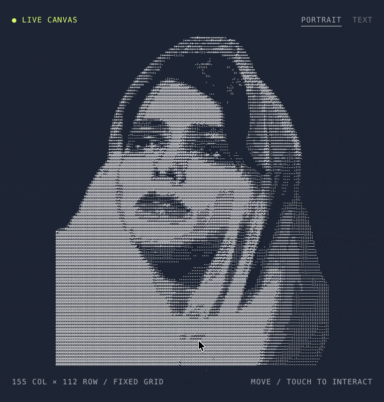

<h1 align="center">Reactive ASCII</h1>

<p align="center">
  <a href="README.md">English</a> · <b>Українська</b>
</p>

<p align="center">
  <strong>Арт тягнеться за курсором. Сітка стоїть на місці.</strong><br>
  Встав свій ASCII-арт, налаштуй ефект повзунками й поділися посиланням або скопіюй код для свого сайту.
</p>

<p align="center">
  
  <a href="#швидкий-старт"></a>
  
  
  
  
  <a href="LICENSE"></a>
</p>

<p align="center">
  <a href="https://agn0st.github.io/reactive-ascii-playground/demo/"></a>
</p>

<p align="center">
  <a href="#швидкий-старт">Швидкий старт</a> · <a href="#свій-арт">Свій арт</a> · <a href="#параметри">Параметри</a> · <a href="#api">API</a> · <a href="#як-це-працює">Як це працює</a>
</p>

<p align="center">
  <a href="https://agn0st.github.io/reactive-ascii-playground/demo/"></a>
</p>

> [!NOTE]
> Кожна клітинка зчитує символ зі зміщеної ділянки оригіналу. Рух курсора розтягує зображення й залишає слід із символів, який поступово згасає. За бажанням можна додати розділення кольорових каналів через WebGL2.

<br>

## Швидкий старт

**1.** Скопіюй `reactive-ascii.js` і `chromatic.js` поруч зі своєю сторінкою.

**2.** Додай полотно, свій арт і скрипти:

```html
<canvas id="ascii" style="width:100%;height:520px;background:#1F2533"></canvas>
<pre id="ascii-art" hidden>
  тут твій ASCII-арт
</pre>

<script src="chromatic.js"></script>
<script src="reactive-ascii.js"></script>
<script>
  ReactiveAscii.create({ canvas: '#ascii', art: '#ascii-art' });
</script>
```

**3.** Якщо змінюєш тло, вкажи той самий колір у CSS та в параметрі `background`. Шейдер
використовує його, щоб зводити розділені канали й не темнити краї знаків.

Це вся інтеграція. `chromatic.js` необовʼязковий — без нього деформація і слід
працюють на звичайному Canvas 2D.

### Без власного JavaScript

```html
<canvas data-reactive-ascii data-art="#ascii-art" data-radius="100" data-trail="0.8"></canvas>
```

Бібліотека сама знаходить полотно за атрибутом `data-reactive-ascii`. У прикладі вище заміни `<canvas>` на цей варіант і прибери виклик `ReactiveAscii.create()`. Залиши розміри полотна, елемент із артом і підключення бібліотеки. Для параметрів із кількох слів використовуй дефіси, наприклад `data-trail-duration`. Параметр `respectReducedMotion` змінюй через JavaScript.

## Свій арт

Годиться будь-що моноширинне — сконвертоване фото, логотип або звичайний блок
тексту. Не обрізай пробіли в кінці рядків: саме вони тримають сітку рівною.

Демо приймає арт трьома способами: вставити в текстове поле, перетягнути `.txt`
на полотно або замінити [`demo/samples/art.txt`](demo/samples/art.txt) — саме його
демо вантажить на старті. Поруч у [`demo/samples/`](demo/samples) лежить текстовий
зразок.

Усі повзунки й палітра живуть в URL, тож вподобаний вигляд — це посилання, яке
можна надіслати: кнопка **Copy link** кладе поточні налаштування в буфер.
Кнопка **Copy code** робить те саме з готовим сніпетом для вставки.

## Параметри

| Параметр | Типово | Що робить |
|---|---|---|
| `art` | — | Рядок, масив рядків, елемент або `"#селектор"` на нього |
| `canvas` | — | Елемент або селектор. Обовʼязковий |
| `radius` | `80` | Радіус впливу курсора, px |
| `strength` | `0.7` | Сила тяги, `0..1` |
| `recovery` | `2000` | Час повернення форми, мс |
| `memory` | `1200` | Як швидко забуваються старі рухи, мс |
| `limit` | `24` | Жорстка межа зміщення, px |
| `aberration` | `0.5` | Розділення каналів, `0..1.5`. Треба `chromatic.js` + WebGL2 |
| `trail` | `0.6` | Густина сліду, `0..1`. `0` вимикає |
| `trailDuration` | `1800` | Тривалість сліду, мс |
| `color` | `'#F6F4F1'` | Колір знаків |
| `background` | `'#1F2533'` | Має збігатися з тлом за полотном |
| `glyphs` | ``'.:;-=+*#%@/\\!?01'`` | Знаки, які перебирає слід |
| `fontSize` | `12` | px при масштабі 1 |
| `cellWidth` / `cellHeight` | `7.2` / `12` | Розміри клітинки при масштабі 1 |
| `paddingX` / `paddingY` | `32` / `80` | Вільне місце при вписуванні арту |
| `respectReducedMotion` | `true` | Зважати на `prefers-reduced-motion` |

Арт вписується в полотно автоматично; `fontSize` і розміри клітинки задають лише
пропорції.

## API

```js
const portrait = ReactiveAscii.create({ canvas: '#ascii', art: myText });

portrait.set({ radius: 120, trail: 0.9 });  // наживо, без перебудови сітки
portrait.setArt(otherText);                 // новий арт, сітка перебудується
portrait.play(2600);                        // скриптований прохід для кнопки «показати»
portrait.reset();                           // скинути деформацію, лишити налаштування
portrait.destroy();                         // зняти слухачі, спостерігач, анімацію

portrait.config;                   // поточні налаштування
portrait.dimensions;               // { rows, cols }
portrait.supported.webgl2;         // false → аберація недоступна
ReactiveAscii.defaults;            // таблиця вище у вигляді обʼєкта
```

## Як це працює

<table>
  <tr>
    <td width="50%" valign="top"><h3>▦ Нерухома сітка</h3><p>Кожна клітинка малює символ зі зміщеної ділянки оригіналу. Завдяки цьому зображення тягнеться, а клітинки лишаються на місці.</p></td>
    <td width="50%" valign="top"><h3>🌀 Пружний рух</h3><p>Згладжений рух курсора тягне зображення. Зміщення має верхню межу й поступово згасає, навіть під час безперервного руху.</p></td>
  </tr>
  <tr>
    <td width="50%" valign="top"><h3>✨ Слід із символів</h3><p>Символи сліду частіше з’являються в порожніх клітинках. Коли слід згасає, проступають символи оригіналу.</p></td>
    <td width="50%" valign="top"><h3>🌈 Розділення кольорів</h3><p>Опційний ефект WebGL2 розводить червоний і синій канали в різні боки вздовж напрямку зміщення.</p></td>
  </tr>
</table>

## Підтримка браузерів

Сучасні браузери. WebGL2 потрібен лише для аберації — без нього повзунок
вимикається, решта працює. `prefers-reduced-motion` зупиняє ефект.

## Структура

```
reactive-ascii.js   рушій і публічний API
chromatic.js        необовʼязковий WebGL2-прохід з аберацією
index.html          редирект на демо, щоб корінь Pages щось відкривав
demo/               демо: повзунки, палітри, завантаження арту, експорт коду
```

## Ліцензія

MIT — див. [LICENSE](LICENSE).
